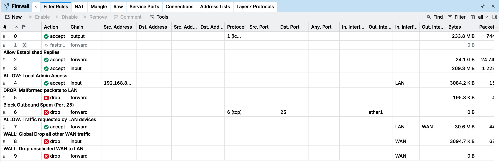
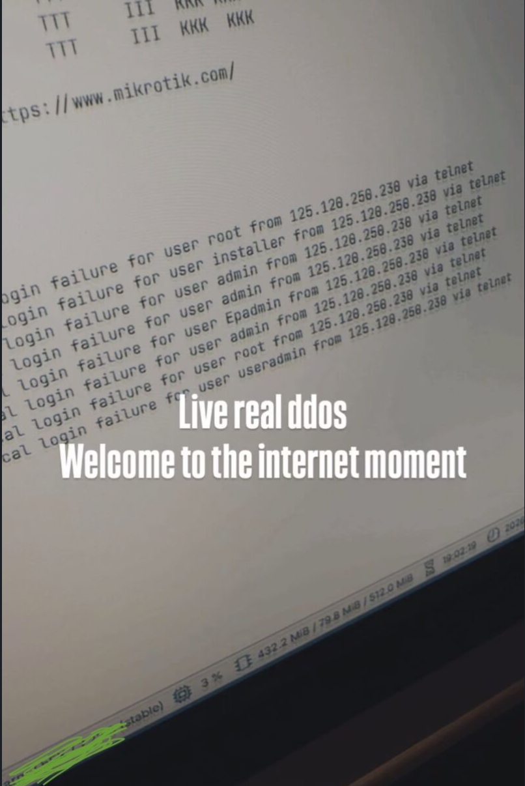
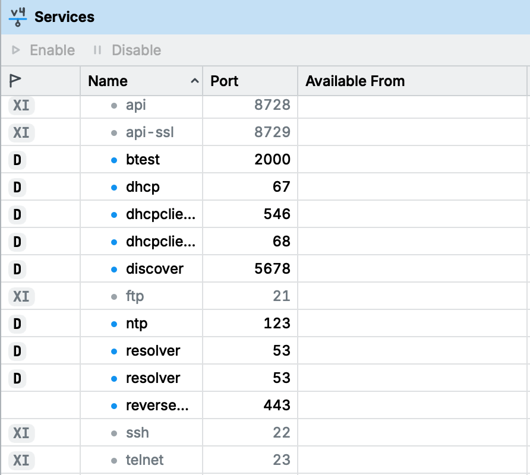
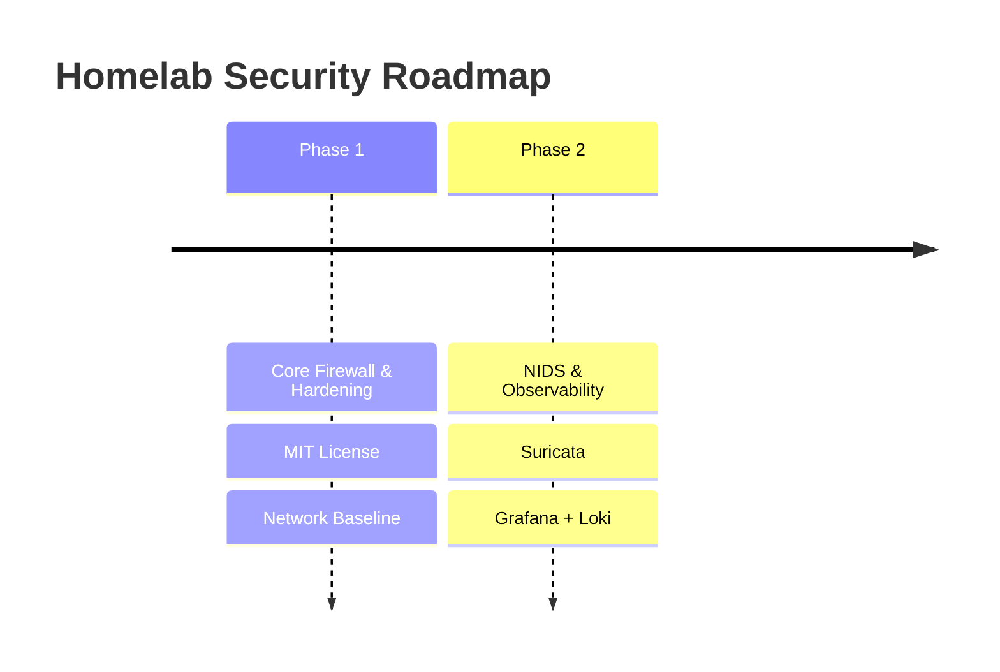

#  Homelab Cybersecurity Stack

[](LICENSE)
[](https://mikrotik.com)
[](https://github.com)

A secure repository containing network configurations, security exports, and defensive stack policies for my homelab environment.

## Objective & Security Rationale

At a fundamental level, this hardening configuration prevents automated botnet scanners from probing open ports and exploiting low-hanging fruit. By closing unmanaged vectors and tightening perimeter filters, the router ignores public internet noise and eliminates default entry points.

## Environment Architecture

- **Hardware/Platform:** MikroTik RouterOS
- **Purpose:** Cybersecurity lab segmentation, traffic inspection, and firewall hardening.

## Visual Overview

Here is an overview of the firewall filter rules providing perimeter protection and traffic segmentation:



## Repository Structure

- `security-lab-export.rsc`: Sanitized MikroTik router configuration export featuring firewall rules, queue trees, interfaces, DHCP, and routing policies.


> 
> > **Note: Real-World Threat Landscape**
> 
> Before applying perimeter defenses, exposed network services are immediately targeted by automated botnets and malicious scanners across the public internet. 
> 
> When administrative interfaces and management ports are left exposed without proper firewall filtering, routers experience continuous, automated brute-force attacks. While the log entry below highlights unauthorized login failures via Telnet, similar aggressive scanning and credential-stuffing attempts occur across other exposed ports and services:
> 
> 
> 

## Service Hardening

Disabled high-risk, unencrypted, and unnecessary management services to minimize the router's attack surface:

* **Disabled Services**: Telnet (23), FTP (21), SSH (22), reverse-poxy (443), API / API-SSL (8728 / 8729), BTest (2000), www (80), www-ssl (443), and external Resolver (53).

 
 
 By enforcing a strict perimeter configuration—blocking unauthorized inbound traffic while explicitly allowing required ICMP, DNS, and dynamic DHCP lease management—the attack surface is eliminated, protecting the router from external compromise.

- [x] **Phase 1: Core Foundation & Hardening**
  - [x] Service surface reduction (disabled legacy protocols like telnet, ftp, www, and api)
  - [x] Secure management restructuring (relocated Winbox to a non-standard port)
  - [x] Access control list enforcement (restricted router management strictly to trusted subnets via available-from rules)
  - [x] Perimeter firewall baseline (dropped invalid states and unauthorized unsolicited inbound traffic from WAN) 
- [ ] **Phase 2: Suricata / Grafana + Loki (NIDS) Setup**
  - [ ] Deploy Suricata Network Intrusion Detection System
  - [ ] Configure Loki for centralized log ingestion
  - [ ] Build Grafana security dashboards for real-time threat intelligence

## 🗺️ Project Roadmap



- [x] **Phase 2: Suricata / Grafana + Loki (NIDS) Setup**
  - [x] Deploy Suricata 8.0.3 Network Intrusion Detection System with MikroTik TZSP capture (`tzsp0`)
  - [x] Configure complex app-layer definitions (`dnp3`, `modbus`) inside `suricata.yaml`
  - [x] Integrate Abuse.ch (`feodotracker`, `urlhaus`, `sslbl-blacklist`, `sslbl-ja3`) & Emerging Threats (`et/open`) rules via `suricata-update`
  - [x] Enable UNIX command socket (`/var/run/suricata/suricata-command.socket`) for zero-downtime live rule reloads (`suricatasc -c reload-rules`)
  - [x] Configure Loki for centralised `eve.json` log ingestion and storage hygiene (in-place truncation preserving root permissions)
  - [x] Build Grafana security dashboards for real-time threat intelligence visualisation

### Promtail Configuration Example (`/etc/promtail/promtail-config.yml`)

```yaml
server:
  http_listen_port: 9080
  grpc_listen_port: 0

positions:
  filename: /tmp/positions.yaml

clients:
  - url: http://localhost:3100/loki/api/v1/push

scrape_configs:
  - job_name: suricata
    static_configs:
      - targets:
          - localhost
        labels:
          job: suricata
          __path__: /var/log/suricata/eve.json
    
```
### 🤝 Contributing

Contributions, feedback, and security hardening recommendations are welcome! Feel free to open an issue or submit a pull request as the project evolves into Phase 2.

## 📄 License

Distributed under the MIT License. See [LICENSE](LICENSE) for more information.


  


